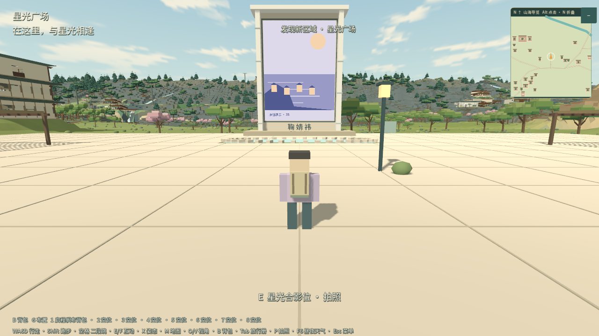
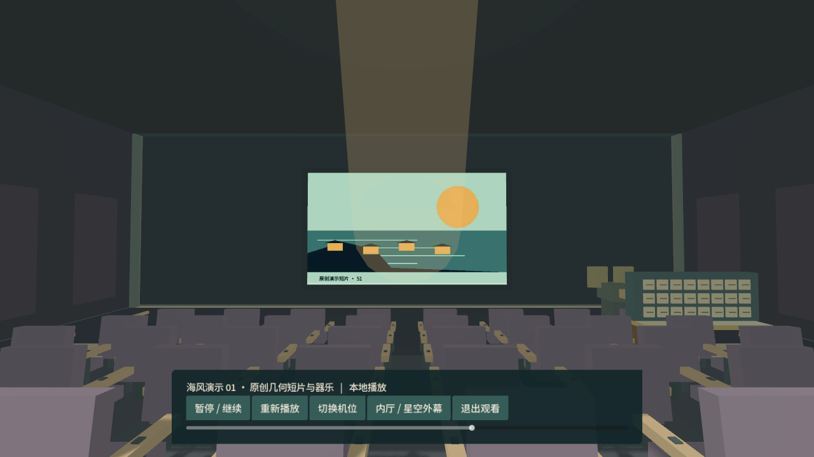

# 小鞠世界 · 开源试玩版

小鞠世界是一款原生 Godot 3D 体素探索游戏，面向 Windows 离线单机。你可以游览海湾、街巷、山林和双岛，进入场馆，乘车船与缆车，采集、制作、布置小屋和保存旅行进度。

这是非官方同人项目。开源版保留 0.12.0 的世界与玩法，照片、歌曲和 MV 位置使用标注清楚的原创演示资源。真人素材与私人收藏未随项目分发。

## 下载与游玩

从 [v0.12.0-open.1 发布页](https://github.com/sanhyen/xiaoju-world/releases/tag/v0.12.0-open.1)下载 Windows 64 位压缩包，解压后双击 `XiaojuWorld.exe`。程序、PCK 和许可文件请保留在同一个文件夹中。游玩无需安装 Godot 或 Python。显卡需要支持 Vulkan。

本版属于公开试玩版。已有工程检查不代表全部建筑的美术验收，也不保证所有电脑达到相同帧率。

## 世界与玩法

- 海岸至山林的连续世界，包含双岛、东岸聚落和七层城郭。
- 83 处建筑、58 处室外地点、130 处登记楼面和 278 条地图目录。
- 保留 501 个既有静态互动 ID 和 63 项物品定义。
- 场馆体验包含画廊、PB、影厅、舞台、声音工作室和各屋工作间。
- 背包、采集、制作、自由布置、地图、拍照、昼夜天气和存档。

| 操作 | 按键 |
| --- | --- |
| 移动、跑步、二段跳 | WASD、Shift、空格 |
| 场馆服务、采集与交通 | E、F |
| 坐卧或观景 | X |
| 背包、布置、旋转 | B、G、R |
| 地图、小地图 | M、N |
| 斜俯视、观察模式、全图 | O、V、Home |
| 拍照、保存照片、保存进度 | P、F12、F5 |
| 昼夜天气 | F6 |

## 打开源码

安装 **Godot 4.7.2 标准版**，在项目管理器中导入本目录的 `project.godot`，等待资源导入后运行主场景。当前世界的烘焙资源随源码保留。

开发和重新导出请阅读 [构建说明](docs/BUILD.md)，检查范围见[首发验证记录](docs/VALIDATION.md)。项目默认使用 Mobile 渲染器和 Vulkan，当前首发目标为 Windows 64 位。

## 媒体与存档

演示图为程序绘制的几何海景，演示节目为 8 秒短片和程序器乐。它们用于体验图片查看、PB、收藏及场馆播放功能。[素材说明](docs/MEDIA.md)列出了来源与许可。

个人素材可通过配套导入工具加入本机的 `UserMedia`。导入是可选功能，需要 Python 与媒体处理依赖。项目不会自动上传个人库。

公开版独立保存至 `%APPDATA%/Godot/app_userdata/小鞠世界 · 开源试玩版/save/open_v1`，不自动导入私人版存档。

## 许可证

项目代码与项目原创资源采用 [MIT](LICENSE)。Noto Sans SC 保留 SIL OFL；三份基础环境 WAV 保留 CC0；Godot 和相关依赖保留各自许可。详细清单见 [第三方声明](LICENSES/THIRD_PARTY_NOTICES.md)。MIT 不构成对任何第三方人物、歌曲、影视或标志的授权。
